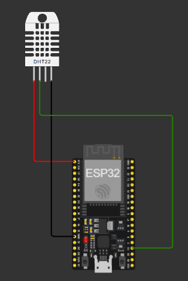
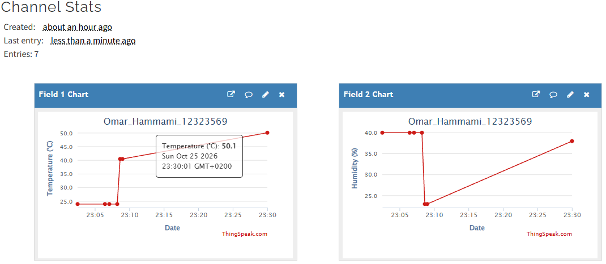
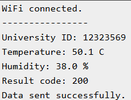

# ESP32 Temperature and Humidity Monitoring

## Student Information

- Full Name: Omar Majdi Hammami
- University ID: 12323569

## Project Description

This project uses an ESP32 and a DHT22 sensor in Wokwi to measure temperature
and humidity. The ESP32 connects to Wi-Fi and sends both readings to ThingSpeak
approximately every 20 seconds. The readings are displayed using the built-in
ThingSpeak charts with timestamps.

The university ID is printed in the Serial Monitor with each reading.

## Project Links

- [ThingSpeak Public Channel](https://thingspeak.mathworks.com/channels/3550044)
- [Wokwi Project](https://wokwi.com/projects/478889978558340097)

## Components

- ESP32 DevKitC V4
- DHT22 temperature and humidity sensor

## Wiring

- DHT22 VCC to ESP32 3V3
- DHT22 GND to ESP32 GND
- DHT22 SDA (DATA) to ESP32 GPIO 15
- DHT22 NC is not connected

The complete Wokwi schematic is included in `diagram.json`.

## ThingSpeak Configuration

- Channel ID: 3550044
- Channel name: Omar_Hammami_12323569
- Field 1: Temperature in degrees Celsius
- Field 2: Humidity in percent
- Channel visibility: Public
- Update interval: approximately 20 seconds

## Libraries

- DHT sensor library for ESPx
- ThingSpeak

The required libraries are listed in `libraries.txt`.

## Running the Project

1. Open the Wokwi project using the link above, or open the included source and schematic in an ESP32 Wokwi project.
2. Use the included `sketch.ino`, `diagram.json`, and `libraries.txt` files.
3. Set `writeAPIKey` to a valid ThingSpeak Write API Key for channel 3550044 before running. If using your own channel, also update `channelID` and enable Fields 1 and 2.
4. Verify that `universityID` is set to `12323569` and the sensor DATA pin is GPIO 15.
5. Keep the simulated Wi-Fi settings as `Wokwi-GUEST` with an empty password.
6. Start the simulation and check the Serial Monitor for `Result code: 200` and `Data sent successfully.`
7. Open the public ThingSpeak channel to view the temperature and humidity charts.
8. Change the DHT22 temperature and humidity values while the simulation runs to test the chart updates.

The included source uses `YOUR_WRITE_API_KEY` as a placeholder. The actual Write
API Key is not included in this package. New readings are sent while the
simulation is running; previously recorded readings remain on ThingSpeak.

## Results

### Temperature and Humidity Charts

### Serial Monitor

The Serial Monitor screenshot shows the university ID, temperature, humidity,
and a successful ThingSpeak update with result code 200.

## Included Files

- `sketch.ino`: ESP32 source code
- `diagram.json`: Wokwi circuit schematic
- `libraries.txt`: required Arduino libraries
- `wokwi-project.txt`: saved Wokwi project link
- `screenshots/wiring.png`: circuit wiring screenshot
- `screenshots/thingspeak.png`: temperature and humidity charts
- `screenshots/serial.png`: Serial Monitor output
